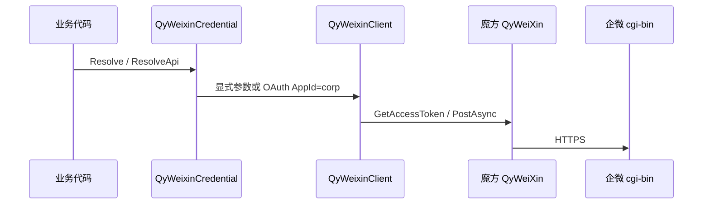

# NewLife.Cube.QyWeixin 架构设计

> 版本：v1.3 | 日期：2026-11-10
> 需求对应：[需求文档](需求文档.md) | 功能清单：[功能清单](功能清单.md)

## 1. 整体架构

类库只有一个程序集 `NewLife.Cube.QyWeixin`，目标框架 net6.0 / net8.0。源码集中在 `src/Shared`，由两个工程分别打包：MVC 宿主用 `src/NewLife.Cube.QyWeixin.Mvc`（包名 `NewLife.Cube.QyWeixin`，依赖 `NewLife.Cube.Core`），WebApi 宿主用 `src/NewLife.Cube.QyWeixin.WebApi`（包名 `NewLife.Cube.QyWeixin.WebApi`，依赖 `NewLife.Cube`）。所有要打 `qyapi.weixin.qq.com` 的调用都从魔方 `QyWeiXin` 派生，使用其 `GetAsync` / `PostAsync` / `GetQyClient` / `GetAccessToken`。二进制素材走 `GetQyClient()` 的 `HttpClient`，因为基类的 Get/Post 会把响应当 JSON 拆。

回调是另一条路：`QyWeixinCallbackController` 用 `QyWeixinCrypt` 验签解密，再交给 `QyWeixinCallbackDispatch`。处理器不直接写 HTTP。

## 2. 组件

| 组件 | 所在工程 | 说明 |
|------|----------|------|
| `QyWeixinClient` | 本库 | 自建应用 API。`QyWeiXinSender` 只保留历史类型名 |
| `QyWeixinAppMessage` | 本库 | message/send 请求体。历史 text 不输出空 totag |
| `QyWeixinCrypt` | 本库 | WXBizMsgCrypt。被动回复与 echostr 拆包 |
| `QyWeixinCallbackDispatch` | 本库 | 先结构化处理器，未消费再走旧 `HandleAsync` |
| `QyWeixinOAuth` | 本库 | 授权 URL。`BuildLikeCube` 调用魔方 Init + Authorize |
| `QyWeixinJsSignature` | 本库 | SHA1 签名。返回值不含 ticket |
| `QyWeixinCredential` | 本库 | 显式参数优先于 OAuth |
| `QyWeixinService` | 本库 | 只读 Cron。部门只建映射，人员按 `PullMode` 决定是否覆盖本地已有行 |
| `OrgExternalMap` | 本库 | 外部身份映射表。`Provider + ObjectType + ExternalId` → `LocalId` |
| `QyWeixinOrgMatch` | 本库 | 企微部门路径计算与本地部门路径索引（不依赖 `Department.Path`） |

## 3. 关键流程

### 3.1 凭据

`QyWeixinCredential.Resolve` 先看 `QyWeixinOptions` 的 CorpID + Secret，否则查租户 0 下启用的 OAuth（Provider=QyWeiXin，或名称含「企业微信」）。AppId 的 `corp#agent` 由魔方 `Init` 拆开。发消息还要求能得到 AgentId。

### 3.2 回调回复

用户消息的处理器返回明文 XML。端点调用 `BuildEncryptedReply`，receiveid 用 OAuth AppId 的企业 ID。事件仍回空串。处理异常只记日志，避免企微按 4xx 重推。

### 3.3 通讯录两条路

写接口只 POST/GET 企微，不改本地 `Department`/`User`。同步作业只 `GetDepartments` / `GetUsers`，把外部身份写进 `OrgExternalMap`。

部门是「本地主数据 + 外部映射」：作业**从不创建或修改** `Department`。每个企微部门先查映射（Provider=`qywx:{企业Id}` 或参数 `Source`，ObjectType=Department）；映射指向的本地部门仍存在就沿用并刷新元数据。没有映射时按企微完整路径匹配本地同名部门（先试含企微根节点的全路径，再试去掉根节点名的短路径），同一本地部门只允许一个企微部门自动占用。匹配不上且不是根节点的，记入返回结果的未匹配列表，不落库。

人员先查映射，再按手机 → 邮箱 → 历史同名（旧版本以企微 userid 作本地用户名）归并。手机/邮箱命中多个、userid 与同名用户手机冲突、本地用户已绑定其它外部 ID 时记冲突跳过。新用户以企微 userid 作 `Name`，手机、邮箱、启用状态（状态 2/5 视为停用）和主部门（优先 `MainDepartment`，否则取第一个能映射的部门）一并写入。`Upsert` 更新已有人员的显示名、启用、主部门；`InsertOnly` 只插入新人员。绑定成功后写回映射表。

映射表 `ConnName=Membership`，与魔方成员库同库，`CheckTableWhenFirstUse` 首次使用自动建表。多来源（钉钉/飞书）共表，靠 `Provider` 隔离。

## 4. 设计决策

| 决策 | 选项 | 选择 | 理由 |
|------|------|------|------|
| API 放哪 | 改 Cube 源码 / 本库派生 | 本库派生 | 任务要求不改 Cube.Core |
| 消息入口 | 改掉三个旧方法的返回值 / 保留 Task 并新增 SendMessageAsync | 保留签名 | 已有告警推送在用旧签名 |
| 授权 | 复制 OAuth 回调 / 只补 URL 和 code 交换 | 只补辅助方法 | 用户落库仍由魔方登录完成 |
| 同步冲突 | 作业双向同步 / 只拉，并用 PullMode 控制是否覆盖本地 | 只拉 | 双向会把本地编辑写回企微，冲掉管理端修改 |
| 多来源组织 | 把外部 ID 塞进 `Department.Code` / 新建业务实体承载映射 | 本地部门为主数据 + 独立映射表 `OrgExternalMap` | `Code` 单命名空间容不下钉钉/企微/飞书多套 ID，`Ex1..Ex6` 是 Int32 也存不下飞书字符串 ID |
| 部门首次绑定 | 自动建本地部门 / 按全路径挂到已有部门 / 只报告不绑定 | 按全路径自动匹配，匹配不上只报告 | 本地部门由管理员维护，自动创建会产生重复组织树 |
| 人员身份 | 按企微 userid 建新用户 / 先归并再固化 | 映射 → 手机 → 邮箱 → 历史同名，冲突不猜 | 避免同一自然人在多来源下重复建号 |
| 日程审批 | 完整控件模型 / 字典薄封装 | 薄封装 | 控件树变化快，半套模型更容易用错 |
| echostr | 保持整段明文字节 / 按官方拆包 | 拆包 | 不拆包时 URL 验证回显对不上 |
| 宿主包 | 两套源码 / 一个工程条件切换 PackageId / 共享源码 + 两个工程目录 | 共享源码 + 两个工程目录 | 两个魔方包程序集名都是 `NewLife.Cube`，不能同时 PackageReference；目录分开后每个工程各自还原、构建、打包，不会共用 `project.assets.json` |

## 5. 双包与回调发现

两个包工程位于 `src/NewLife.Cube.QyWeixin.Mvc` 与 `src/NewLife.Cube.QyWeixin.WebApi`，各自引用不同的魔方包，并通过 `Compile Include="..\Shared\**\*.cs"` 链接同一份源码，程序集名都保持 `NewLife.Cube.QyWeixin`。因为工程目录独立，两个包各有自己的 `obj` / `bin` 和 `project.assets.json`，不需要再按属性切换中间目录。`Directory.Build.props` 只保留公共语言选项和构建产物排除规则。测试工程与 `test/WebApiHost` 统一引用 MVC 包工程，避免两个同名程序集进入同一输出目录；WebApi 包由解决方案构建并单独 `pack`。

`QyWeixinCallbackController` 的基类是 `ControllerBase`。WebApi 版 `AddCube`（`NewLife.Cube/CubeService.cs`）不写 `ApplicationPartManager`。MVC 版 `AddCube` 只把含 `ControllerBaseX` 或 `RazorPage` 的已加载程序集加进去，扫不到这个控制器。

ASP.NET Core Web SDK 在宿主编译时用 `FindAssembliesWithReferencesTo` 查找引用了 `Microsoft.AspNetCore.Mvc.Core` 的程序集，并生成 `ApplicationPartAttribute`。本库引用了 `Microsoft.AspNetCore.App` 且控制器在 `Microsoft.AspNetCore.Mvc` 里，因此宿主工程直接引用对应包并调用 `AddControllers` / `AddControllersWithViews` 后，`/QyWeixin/Callback` 进入动作表。`test/WebApiHost` 是这个路径的最小宿主，单测断言属性与两个 Action，不额外调用 `AddApplicationPart`。本程序集不在 Web 工程编译引用闭包里时，宿主再对 `AddControllers()` 调用 `AddApplicationPart`。
